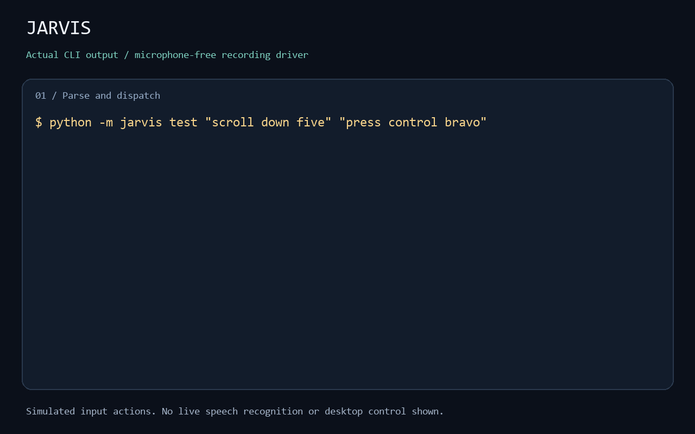

# Jarvis

Hands-free control of a Windows machine. Say **"Jarvis"**, then say what you want.

```
"jarvis switch to firefox"     -> focuses Firefox, launching it if it isn't running
"jarvis scroll down"           -> scrolls
"jarvis"                       -> beep; now listening
"scroll down"                  -> scrolls
"scroll down five"             -> scrolls further
"grid" ... "five" ... "click"  -> points at anything on screen and clicks it
"jarvis dictate"               -> hands off to Wispr Flow for prose
"jarvis plan mode"             -> Shift+Tab ×2 in Claude Code
```

Command recognition runs locally with Vosk and needs no API key after the model download.
The optional Wispr Flow handoff and commands that open networked apps have their own
network and privacy behaviour; Jarvis does not make those apps offline.

---

## The idea

Two recognisers, each doing the thing it is good at.

**Jarvis** runs a *restricted grammar*: the decoder is told that the only words
anyone will ever say are the ~400 that your commands actually use. It stops
guessing at English and starts choosing between commands, which is why short
commands land reliably and why background conversation mostly doesn't trigger
anything. The cost is that it genuinely cannot hear anything else.

**Wispr Flow** handles prose. `"jarvis dictate"` presses its hotkey and gets
out of the way; `"jarvis send it"` presses Enter when you're done. Jarvis
drives everything around the text — approving tool calls, switching windows,
scrolling a diff — and Wispr Flow writes the text.

The division of labour is the whole design. A single recogniser good enough for
free-form prose is too loose to be trusted with "close window".

---

## Demo



[Watch the MP4](docs/media/terminal-demo.mp4) ·
[View the still](docs/media/terminal-demo.png) ·
[Read the captured output](docs/media/terminal-demo.txt)

This terminal presentation renders actual output from `jarvis test`: command
parsing, app aliases, chained commands and the wake-word state machine. Actions
use the recording driver. It does **not** demonstrate microphone recognition,
real app switching or desktop control; the timing is a presentation of captured
output, not a latency measurement. No audio is included.

## Try the command pipeline without a microphone

Requires Python 3.10+ and Git. From a checkout:

```powershell
py -3 -m venv .venv
.venv\Scripts\python -m pip install -e ".[dev]"
.venv\Scripts\python -m jarvis test "scroll down" "switch to terminal"
.venv\Scripts\python -m pytest
```

The `test` command uses a recording driver: it prints actions without sending input,
opening apps or using the microphone. It works on Windows and Linux, and does not
need an acoustic model. This demonstrates parsing and dispatch, not speech accuracy.

## Install (Windows)

Use 64-bit Python 3.10+ (the python.org installer includes tkinter), Git and a microphone.
Setup needs internet access to install dependencies and download the Vosk model.

```powershell
# Clone this repository using its GitHub or GitLab Code button, then:
cd jarvis
powershell -ExecutionPolicy Bypass -File scripts\setup.ps1
```

That creates a venv, installs the three dependencies, downloads the ~40 MB
speech model and writes you a `jarvis.yaml`. Then:

```powershell
notepad jarvis.yaml       # optionally configure Wispr Flow or omit its pack
.\scripts\run.ps1
```

Try it without letting it touch anything first:

```powershell
.\scripts\run.ps1 -DryRun     # recognises and matches, prints instead of acting
```

**Start it at logon** (Scheduled Task, no console window):

```powershell
powershell -ExecutionPolicy Bypass -File scripts\install-startup.ps1
```

### Manual install

```powershell
py -3 -m venv .venv
.venv\Scripts\python -m pip install -e ".[dev]"
.venv\Scripts\python -m jarvis download-model small-en-us
.venv\Scripts\python -m jarvis init
.venv\Scripts\python -m jarvis doctor
```

---

## Using it

### Two ways to speak a command

**One-shot** — prefix with the wake word. Best when you say one thing and go
back to what you were doing.

```
"jarvis scroll down"
```

**Armed** — say "Jarvis" alone. You get a beep and a five-second window in
which bare commands work, and every command you give extends the window. Best
for a run of commands.

```
"jarvis"  →  beep
"scroll down"
"scroll down"
"next tab"
   ...five seconds of silence, and it disarms
```

Both work at once; you don't have to pick. `"stand down"` ends the window
early, `"go to sleep"` ignores everything until you say the wake word again.

### Chaining

```
"jarvis scroll down then next tab"
```

### Pointing at things — the grid

Clicking is the hard part of hands-free, so there's a recursive grid:

```
"jarvis grid"   →  a numbered 3×3 overlay covers the screen
"five"          →  zooms into cell 5; the mouse moves to its centre
"five"          →  zooms again
"click"         →  clicks
```

Three zooms takes you from a 1920×1080 screen to a 71×40 box — precise enough
for any button. `"grid off"` dismisses it.

### Seeing what it heard

`jarvis run` prints every utterance and what it did with it:

```
◉ "jarvis"                    listening
✓ "scroll down"               scroll down 3
· "what shall we have"        no command matched
✗ "press flurb"               core.press: don't know the key 'flurb'
```

The beeps tell you the same thing without looking: rising for *listening*,
higher for *done*, low for *failed*.

---

## Customising it

Everything lives in `jarvis.yaml`. See `jarvis.example.yaml` — it's the
annotated version of every option.

```bash
jarvis commands            # every command and phrase
jarvis commands scroll     # just the ones mentioning "scroll"
jarvis test "scroll down"  # match a phrase without a microphone
jarvis words --all         # the exact vocabulary the recogniser can hear
jarvis devices             # microphones
jarvis doctor              # check the install
```

### A new command

```yaml
commands:
  - id: my.standup
    phrases: ["open standup", "standup doc"]
    action: launch
    args: {command: 'start "" https://example.com/standup'}
```

### Changing a built-in

Reuse its `id` — `jarvis commands` shows them all:

```yaml
commands:
  - id: nav.scroll-down
    phrases: ["scroll down", "down a bit"]
    action: scroll
    args: {direction: down, amount: 8}    # bigger jumps than the default 3
```

Or turn it off:

```yaml
disable: [nav.close-window]
```

### A new app

```yaml
lists:
  apps:
    my inbox:
      label: Thunderbird
      process: thunderbird.exe
      launch: 'start "" thunderbird.exe'
```

You can now say *"switch to my inbox"*, *"open my inbox"*, *"go to my inbox"* —
one entry, every phrasing, because the app phrases are defined once against the
list.

`process` may be a list, which is how *"switch to terminal"* reaches whichever
terminal you actually have open:

```yaml
    terminal:
      process: [WindowsTerminal.exe, powershell.exe, pwsh.exe, cmd.exe]
      launch: wt
```

Several names can share one definition with `alias_of`, so a long spec doesn't
get copied around and drift apart:

```yaml
    console:   {alias_of: terminal}
    the shell: {alias_of: terminal, label: My Shell}   # keys you give win
```

**Repeating the command cycles.** You usually have one browser but three
terminals, so saying *"switch to terminal"* again moves to the next one and
wraps around. Which one is next is worked out from what's in front right now,
so it stays correct as you open and close windows. Coming back from a different
app starts at the first again. Set `args: {cycle: false}` on an override to
always land on the same window.

### Phrase syntax

| | |
|---|---|
| `scroll down` | literal words |
| `scroll down {n:number}` | a spoken number — "twenty three" → `23` |
| `switch to {app:apps}` | the longest match from a named list |
| `type {text:rest}` | everything remaining, as a string |
| `press {key:word}` | exactly one word |
| `scroll {n:number?}` | `?` makes a slot optional |

Slot values reach the action as `{name}` in `args`, keeping their type —
`"{n}"` gives you the integer `7`, not `"7"`.

### Actions

`keys` `press` `type` `scroll` `click` `mouse_move` `mouse_center` `focus_app`
`window` `switch_window` `launch` `sequence` `wait` `grid_show` `grid_pick`
`grid_click` `grid_hide` `arm` `disarm` `sleep` `wake` `repeat` `quit` `noop`

`sequence` composes them:

```yaml
  - id: my.commit
    phrases: ["commit everything"]
    action: sequence
    args:
      steps:
        - {action: type, args: {text: "git add -A && git commit"}}
        - {action: keys, args: {chord: enter}}
```

### Pressing keys by voice

`press` parses spoken key names, including the NATO alphabet — which matters,
because single letters are the one thing every recogniser gets wrong:

```
"jarvis press control shift p"    ->  ctrl+shift+p
"jarvis press control bravo"      ->  ctrl+b
"jarvis press alt f four"         ->  alt+f4
```

---

## What ships in the box

| Pack | What it covers |
|---|---|
| `core` | Jarvis's own state, clipboard, undo/save, pressing arbitrary keys |
| `navigation` | Scrolling, mouse, the grid, windows, tabs, browser navigation |
| `apps` | "switch to firefox", "switch to terminal" — 33 aliases, extend freely |
| `dictation` | Wispr Flow handoff, send, new line, clear field |
| `claude_code` | Accept/reject, plan mode, interrupt, slash commands, diffs, VS Code |

105 commands, 276 phrases. Drop any pack you don't want from `packs:`.

---

## Tuning

**It mishears the wake word.** Run it and watch what gets printed when you say
"Jarvis". If there's a consistent near-miss, add it to `wake_aliases`.

**It acts on things you didn't say.** Raise `recognition.fuzzy_threshold`
toward `1.0` (exact matching only). Check `feedback.show_ignored: true` output
to see what it's hearing. If a bare number moving the mouse is the problem,
`disable: [nav.grid-pick]`.

**It ignores you.** Lower `fuzzy_threshold`. Check the microphone with
`jarvis devices` and set `audio.device`. Confirm your phrase is actually
listed: `jarvis commands <word>`.

**It feels slow.** Lower `audio.blocksize` (4000 samples = 250 ms at 16 kHz).
`recognition.use_partials: true` requests partial recognition results; partials
change as you speak. The current command loop ignores partial results, so this
setting does not currently reduce command latency.

**Accuracy generally.** `jarvis download-model lgraph-en-us` is 1.8 GB and
noticeably better, and still supports the restricted grammar. The plain large
models do not — set `recognition.restrict_grammar: false` if you use one, and
expect more misfires.

---

## Known limits

- **Elevated windows.** Windows blocks synthetic input from a normal-privilege
  process into an elevated one. An un-elevated Jarvis cannot type into an admin
  PowerShell. Running Jarvis elevated fixes that and is a real security
  trade-off — it means anything that can reach the microphone can reach an
  admin prompt.
- **No dictation.** By design; that's Wispr Flow's job. The restricted grammar
  is what makes the commands reliable, and it's mutually exclusive with
  open-vocabulary transcription.
- **`{rest}` slots are grammar-bound.** `"type hello"` only works if "hello" is
  in the vocabulary. Add words with `recognition.extra_words`.
- **The grid overlay needs tkinter**, which ships with python.org Python but is
  omitted by some distributions. Everything else works without it.

---

## Privacy and local configuration

Jarvis reads the microphone while `run` is active. Vosk recognition is local; Jarvis
has no audio-upload or telemetry client. Console feedback can include recognised
speech and command text. Avoid sharing terminal captures containing private speech.
`jarvis.yaml`, models and logs are excluded from Git; keep personal paths, account
links and custom shell commands in that local file.

Wispr Flow is optional and separately installed. Remove `dictation` from `packs`
if you do not use it. Likewise, the `claude_code` pack assumes that application's
shortcuts; remove it if unnecessary. Review custom commands as executable code:
`launch` and `sequence` can run shell commands with your user permissions.

## Development

Written on Linux, run on Windows. Everything except `jarvis run` works on
either, because the Windows driver sits behind a `Driver` interface with a
recording `NullDriver` beside it.

```bash
./scripts/dev.sh test              # matcher, engine, grid and configuration tests
./scripts/dev.sh try "scroll down" # push a phrase through the whole pipeline
./scripts/dev.sh commands grid
```

```
src/jarvis/
  listener.py    microphone -> Vosk -> utterances
  grammar.py     builds the restricted vocabulary from the loaded commands
  matcher.py     transcript -> command + slots
  numbers.py     "twenty three" -> 23
  keymap.py      "control shift p" -> ctrl+shift+p
  engine.py      wake-word state machine and dispatch
  config.py      packs + your yaml, layered
  packs/         the shipped commands
  actions/       what a command can do
  drivers/       windows.py (ctypes SendInput) and null.py (records calls)
  overlay.py     the grid, in its own process so tkinter can own a thread
```

The Windows driver is pure `ctypes` — no pyautogui, no pywin32. It uses
`SendInput` with scancodes, which is what terminals, Electron apps and games
actually listen to; the `keybd_event` path the common libraries still use is
ignored by a lot of software.

### Verification limits

Automated tests use the recording driver. They do not establish microphone accuracy,
real Windows input delivery, grid rendering or compatibility with every target app.
For a device smoke test, start with `scripts\run.ps1 -DryRun`, verify recognition,
then try scrolling and the grid in an empty Notepad window. Confirm `stand down`,
`go to sleep` and Ctrl+C before using commands in your normal workflow.

No project licence has been selected yet. The Vosk models and dependencies have
their own licences; downloading a model does not change this project's licensing.

### Recreate demo media

Install `pillow` and `imageio-ffmpeg` in a separate development environment, then
run `python scripts/render-demo.py` from the checkout. The script captures real CLI
output and renders the still, GIF, MP4 and text transcript in `docs/media/`.
These media tools are optional and are not runtime dependencies.
